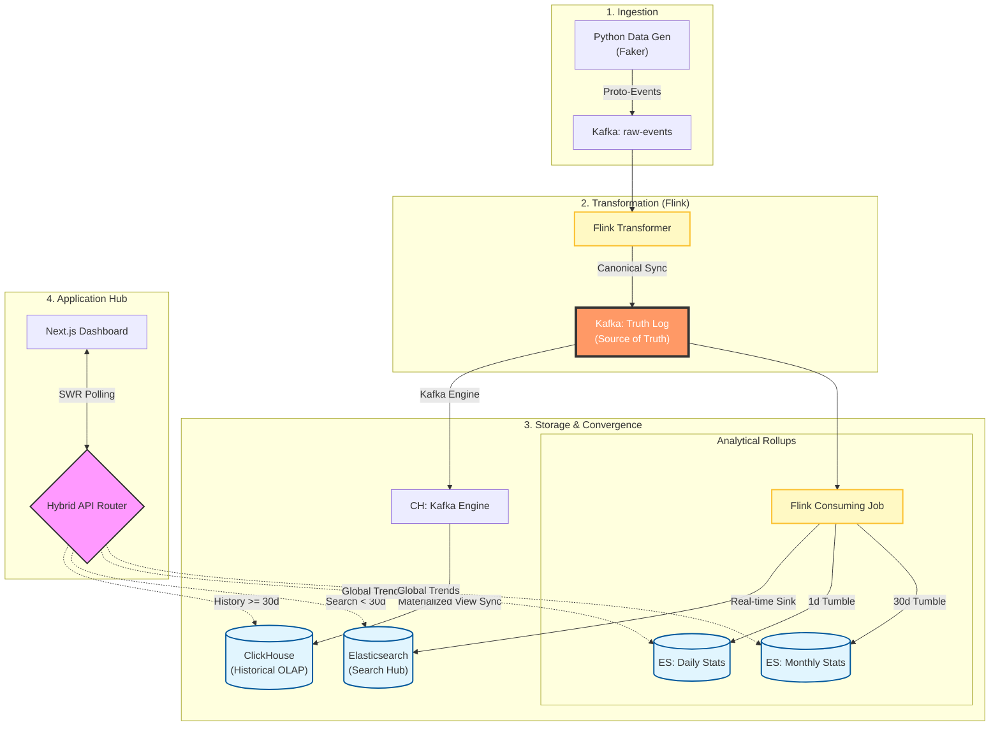

# FinPulse

FinPulse is a production inspired, end to end **real time financial analytics platform** designed to simulate how modern banks, wallets, and payment gateways process and analyze high velocity transaction streams.

The platform demonstrates how raw financial events such as P2P transfers, merchant payments, and digital transactions can be ingested, processed, aggregated, and visualized **within seconds**, while preserving correctness, scalability, and analytical depth.

Built on **Apache Kafka** and **Apache Flink**, FinPulse performs stateful stream processing and time windowed aggregations on live transaction data. **Elasticsearch** serves as the analytical store for both raw events and precomputed rollups, while **Next.js** powers an interactive dashboard that exposes KPIs, trends, and anomalies in near real time.

FinPulse is intentionally designed to mirror **real world banking and fintech workloads**, including:

- High throughput ingestion
- Event driven stream processing
- Temporal aggregations for daily and monthly insights
- High value transaction detection
- Searchable transaction and entity level views


---


## Architecture

FinPulse follows a **Log-Centric Architecture**, where a single canonical Kafka topic serves as the immutable "Source of Truth" for all downstream analytical stores.




---


### Technology Stack

| Component | Technology | Version | Description |
| :--- | :--- | :--- | :--- |
| **Frontend** | Next.js | 14 | React framework with Tailwind CSS and Recharts. |
| **Backend API** | Next.js API | 14 | Serverless functions for Elasticsearch queries. |
| **Stream Processing** | Apache Flink | 1.18 | Stateful stream processing and windowed aggregations. |
| **Messaging** | Apache Kafka | 7.5 | High-throughput distributed event streaming. |
| **Storage (OLTP/Real-time)** | Elasticsearch | 7.17 | Search engine and real-time analytics store. |
| **Storage (OLAP/History)** | ClickHouse | 23.8 | High-performance column-oriented store for long-term analytics. |
| **Data Gen** | Python | 3.11 | Synthetic financial transaction generator using Faker. |


---


### The "Truth Log" Pattern

At the core of FinPulse is a **Log-Centric Architecture**. Unlike traditional pipelines where data is pushed directly to a database, we treat a specific Kafka topic (`{KAFKA_TOPIC}-normalized`) as the **immutable, canonical source of truth**.
- **Data Parity**: Since both ClickHouse (OLAP) and Elasticsearch (Search) consume from this same log, they are guaranteed to stay in sync.
- **Replayability**: New services or analytical engines can be "hydrated" at any time by simply replaying the Truth Log from a specific offset.
- **Decoupling**: The transformation logic is isolated from storage-specific dialects, allowing the Flink processor to remain lean and scalable.


### Hybrid Analytical Strategy

FinPulse leverages a tiered storage model to balance sub-second latency with deep historical depth:
- **Elasticsearch (Real-time Hub)**: Optimized for point-lookups, 24-hour KPI windows, and full-text transaction searching. It provides the "Pulse" of the system.
- **ClickHouse (OLAP Engine)**: A column-oriented powerhouse used for complex time-series aggregations, month-over-month growth trends, and multi-year historical audits.


#### Routing Decision Logic

The API layer implements an **Intelligent Hybrid Router** that evaluates incoming queries based on temporal range and aggregation complexity:
| Query Range | Primary Store | Rationale |
| :--- | :--- | :--- |
| **Real-time (< 1h)** | Elasticsearch | Sub-millisecond indexed search for the "latest" events. |
| **Short-term (< 30d)** | Elasticsearch | Leverages pre-computed Flink rollups and BKD-trees for fast filtering. |
| **Historical (>= 30d)** | ClickHouse | Optimized for heavy columnar scans and year-over-year math. |
| **Custom Range** | Hybrid | Transparently selects the engine to ensure consistent 300ms response times. |


### Event-Time & Watermarking

Financial data is often out-of-order. FinPulse uses Flink's **Event-Time** processing instead of ingestion-time:
- **Watermarks**: 5-second out-of-order allowance ensures that late-arriving transactions are correctly accounted for in their respective time windows.
- **Deterministic Aggregations**: Guarantees that the same transaction stream will always produce the same result, regardless of network delays or system restarts.


### Operational Excellence (`run.sh`)

The platform is designed for **Zero-Touch Initialization**. The `run.sh` script automates the entire lifecycle:
- **Autonomous Setup**: Automatically downloads missing Flink JARs, prepares Kafka topics, and initializes multi-service schemas.
- **Health-Aware Orchestration**: Uses iterative polling (Wait-For-Ready checks) to ensure that inter-dependent services (like Flink-to-Kafka or ES-to-Infra) boot in the correct logical sequence.


### Flexible Schema Mapping

The system is built to ingest diverse financial data formats via a decoupled mapping layer:
- **`source_mapping.json`**: This configuration file allows administrators to map raw Kafka fields to the canonical FinPulse schema without writing a single line of Java/Python.
- **Normalizer Logic**: The Flink processor dynamically loads this mapping to handle field renames, data type casting, and default value injection (e.g., fallback currencies) on the fly.


---


## Setup

The fastest way to start the entire platform is using the manager script:

```bash
# 1. Start everything (Infra, Job, Data Gen, UI)
./run.sh all

# 2. Check status
./run.sh status
```

**If you need to manage components separately:**

- `./run.sh infra`: Start only Docker containers.
- `./run.sh job`: Submit the Flink processing job.
- `./run.sh gen`: Start/Restart the Data Generator.
- `./run.sh ui`: Start/Restart the Dashboard.
- `./run.sh stop`: Shut down all processes and containers.
- `./run.sh logs gen`: Tail the Data Generator logs.


---


## Ports Reference

| Service | Port | Description |
| :--- | :--- | :--- |
| **Dashboard** | http://localhost:3000 | Next.js Frontend & API |
| **Flink UI** | http://localhost:8081 | Flink Job Monitoring |
| **Kafka** | http://localhost:9092 | Messaging Broker |
| **Elasticsearch** | http://localhost:9200 | REST API for Search |
| **ClickHouse** | http://localhost:8123 | OLAP Query API |
| **Kibana** | http://localhost:5601 | Data Visualization UI |


---


## Input Data

### Current

| Field           | Type     | Description                            | Example                                          |
| :-------------- | :------- | :------------------------------------- | :----------------------------------------------- |
| `transactionId` | `string` | Unique UUID for the transaction.       | `f47ac10b-58cc-4372-a567-0e02b2c3d479`           |
| `sourceId`      | `string` | ID of the sender (from user pool).     | `u_123`                                          |
| `sourceName`    | `string` | Name of the sender.                    | `John Doe`                                       |
| `targetId`      | `string` | ID of the receiver (Merchant or User). | `m_uber` (Merchant) or `u_456` (Peer)            |
| `targetName`    | `string` | Name of the receiver.                  | `Uber` or `Jane Smith`                           |
| `amount`        | `float`  | Transaction value (weighted random).   | `42.50`                                          |
| `currency`      | `string` | Currency code (Hardcoded).             | `USD`                                            |
| `ts_str`        | `string` | Local timestamp string.                | `2026-02-17 14:45:00`                            |
| `type`          | `string` | Transaction type.                      | `P2P` (Peer-to-Peer) or `P2M` (Peer-to-Merchant) |
| `category`      | `string` | Merchant category or "Transfer".       | `Transport`, `Food & Drink`, `Transfer`          |


---


### Next

| Field                   | Data Type | Description                                                  |
| ----------------------- | --------- | ------------------------------------------------------------ |
| tran_id                 | string    | Unique transaction identifier                                |
| tran_date               | datetime  | Local transaction datetime                                   |
| user_id                 | string    | Initiating user identifier                                   |
| account_id              | string    | Initiating account or wallet identifier                      |
| counterparty_user_id    | string    | Counterparty user identifier (nullable for merchants)        |
| counterparty_account_id | string    | Counterparty account or wallet identifier                    |
| transaction_type        | string    | Nature of transaction. P2P, P2M, M2P, B2B, SELF              |
| payment_method          | string    | Payment rail or instrument. QR, IBFT, WALLET, BANK_TRANSFER, CARD |
| merchant_id             | string    | Merchant identifier. Null for non merchant transactions      |
| merchant_category       | string    | Business category. FOOD, GROCERY, TRAVEL, UTILITIES, EDUCATION, HEALTH |
| mcc_code                | string    | Standard merchant category code (ISO). Nullable              |
| amount                  | decimal   | Transaction amount                                           |
| currency                | string    | Currency code. NPR, USD                                      |
| remark                  | string    | User or system remarks                                       |
| channel                 | string    | Initiation channel. Mobile, Web, POS, API                    |
| transaction_status      | string    | SUCCESS, FAILED, PENDING, REVERSED                           |
| reference_tran_id       | string    | Reference transaction id for reversal or refund              |
| created_at              | datetime  | System ingestion timestamp                                   |


---


## Features

- **Real-time Data Stream**: High-throughput processing of financial events.
- **Advanced Aggregations**: Dynamic volume tracking (1s/1m windows).
- **Anomaly Alerting**: Immediate notifications for high-value or unusual activities.
- **Robust Searching**: Support for User, Entity, and Transaction Ledger lookups.
- **Data Sync**: Real-time heartbeats synchronized across all analytics views.


---


## Scalability & Performance

This architecture is designed for high-throughput, low-latency financial workloads.

### Ingestion & Support (Kafka)

- **Traffic Handling**: Kafka handles millions of events per second. It ensures data persists even if downstream consumers (Flink) are temporarily offline.
- **Horizontal Scaling**: Adding more partitions allows more concurrent Flink consumers.


---


### Stream Processing (Flink)

- **Latency**: Sub-millisecond stateful processing.
- **Scalability**: Flink clusters can scale to thousands of nodes. It handles backpressure automatically, ensuring the UI stays responsive even during traffic spikes.
- **State Management**: Uses RocksDB for multi-terabyte state management (e.g., tracking "Top Spender" over years).


---


### Storage & Analytics (Elasticsearch)

- **Historical Capacity**: Elasticsearch supports petabytes of data using **Index Lifecycle Management (ILM)**.
- **Fast Lookups**: Even with billions of records, the use of Keyword fields and BKD-trees for amounts ensures milliseconds for complex aggregations.
- **Aggregated Rollups**: Our Flink job pre-calculates interval-based stats, reducing storage costs for long-term trends by **~99%**.


---


### Application Layer (Next.js)

- **Stateless API**: Easily deployed in containers (K8s/Docker) and load-balanced.
- **Optimized Fetching**: Server-side pagination and debounced searching prevent UI bottlenecks.


---


## Architectural Roadmap

While the current stack is robust, the following improvements would further enhance production readiness:

1.  **Exactly-Once Semantics**: Tuning Flink checkpoints and Elasticsearch transactional sinks to guarantee zero data loss or duplication.
2.  **Schema Enforcement**: Integrating Confluent Schema Registry to enforce Avro/Protobuf contracts on the data stream.
3.  **Real-time Push (WebSockets/SSE)**: Replacing the current HTTP polling mechanism with WebSockets to further reduce latency and API overhead.
4.  **Multi-Tiered Storage**: Automatically archiving aged raw data from Elasticsearch to Apache Iceberg or S3 for long-term compliance auditing at lower cost.
5.  **AI/ML Anomaly Detection**: Integrating a Flink-ML module or side-calls to a real-time inference endpoint for advanced financial fraud detection.
