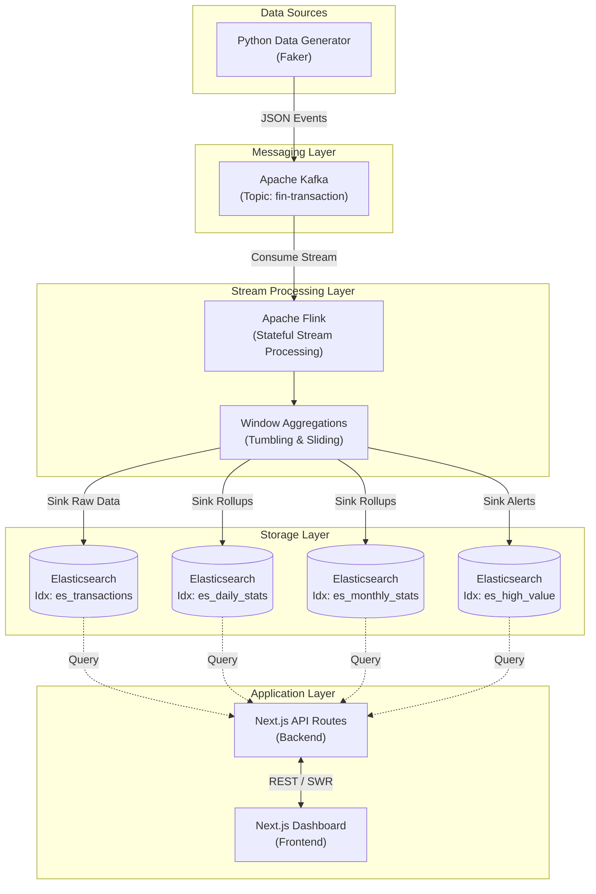

# FinPulse

A high-performance real-time analytics dashboard for diverse financial data streams, built with **Apache Flink**, **Kafka**, **Elasticsearch**, and **Next.js**.


## Architecture



### Technology Stack

| Component | Technology | Version | Description |
| :--- | :--- | :--- | :--- |
| **Frontend** | Next.js | 14 | React framework with Tailwind CSS and Recharts. |
| **Backend API** | Next.js API | 14 | Serverless functions for Elasticsearch queries. |
| **Stream Processing** | Apache Flink | 1.18 | Stateful stream processing and windowed aggregations. |
| **Messaging** | Apache Kafka | 7.5 | High-throughput distributed event streaming. |
| **Storage** | Elasticsearch | 7.17 | Search engine and analytics store. |
| **Data Gen** | Python | 3.11 | Synthetic financial transaction generator using Faker. |

### Data Pipeline Flow

1.  **Ingestion**: 
    *   The `datagen` service (Python) generates realistic financial transactions (payments, transfers, withdrawals) using the Faker library.
    *   Events are serialized to JSON and published to the `fin-transaction` Kafka topic.

2.  **Stream Processing**:
    *   Apache Flink consumes the Kafka stream.
    *   **Watermark Strategy**: Assigns event-time watermarks (allowing for 5-second out-of-order data) to handle late arrivals correctly.
    *   **Transformation**: The stream is split into multiple logical flows:
        *   **Raw Storage**: All events are indexed into `es_transactions` for granular search.
        *   **High-Value Detection**: Transactions > $5,000 are filtered and sunk to `es_high_value`.
        *   ** Entity Flows**: Debits and credits are split to track per-user/merchant cash flow in `es_entity_flows`.
        *   **Temporal Aggregations**: Tumbling windows calculate metrics (Volume, Count, Unique Users) for Daily (`es_daily_stats`) and Monthly (`es_monthly_stats`) rollups.

3.  **Presentation**:
    *   The Next.js Dashboard polls the API layer.
    *   API routes construct complex boolean queries to retrieve data from Elasticsearch.
    *   The UI renders real-time charts (Recharts) and KPI tiles, refreshing every few seconds to reflect the live data stream.


## Setup

The fastest way to start the entire platform is using the manager script:

```bash
# 1. Start everything (Infra, Job, Data Gen, UI)
./run.sh all

# 2. Check status
./run.sh status
```

**If you need to manage components separately:**

- `./run.sh infra`: Start only Docker containers.
- `./run.sh job`: Submit the Flink processing job.
- `./run.sh gen`: Start/Restart the Data Generator.
- `./run.sh ui`: Start/Restart the Dashboard.
- `./run.sh stop`: Shut down all processes and containers.
- `./run.sh logs gen`: Tail the Data Generator logs.


## Ports Reference

| Service | Port | Description |
| :--- | :--- | :--- |
| **Dashboard** | http://localhost:3000 | Next.js Frontend & API |
| **Flink UI** | http://localhost:8081 | Flink Job Monitoring |
| **Kafka** | http://localhost:9092 | Messaging Broker |
| **Elasticsearch** | http://localhost:9200 | REST API for Search |
| **Kibana** | http://localhost:5601 | Data Visualization UI |


## Features

- **Real-time Data Stream**: High-throughput processing of financial events.
- **Advanced Aggregations**: Dynamic volume tracking (1s/1m windows).
- **Anomaly Alerting**: Immediate notifications for high-value or unusual activities.
- **Robust Searching**: Support for User, Entity, and Transaction Ledger lookups.
- **Data Sync**: Real-time heartbeats synchronized across all analytics views.


## Scalability & Performance

This architecture is designed for high-throughput, low-latency financial workloads.

### Ingestion & Support (Kafka)

- **Traffic Handling**: Kafka handles millions of events per second. It ensures data persists even if downstream consumers (Flink) are temporarily offline.
- **Horizontal Scaling**: Adding more partitions allows more concurrent Flink consumers.


### Stream Processing (Flink)

- **Latency**: Sub-millisecond stateful processing.
- **Scalability**: Flink clusters can scale to thousands of nodes. It handles backpressure automatically, ensuring the UI stays responsive even during traffic spikes.
- **State Management**: Uses RocksDB for multi-terabyte state management (e.g., tracking "Top Spender" over years).


### Storage & Analytics (Elasticsearch)

- **Historical Capacity**: Elasticsearch supports petabytes of data using **Index Lifecycle Management (ILM)**.
- **Fast Lookups**: Even with billions of records, the use of Keyword fields and BKD-trees for amounts ensures milliseconds for complex aggregations.
- **Aggregated Rollups**: Our Flink job pre-calculates interval-based stats, reducing storage costs for long-term trends by **~99%**.


### Application Layer (Next.js)

- **Stateless API**: Easily deployed in containers (K8s/Docker) and load-balanced.
- **Optimized Fetching**: Server-side pagination and debounced searching prevent UI bottlenecks.


## Architectural Roadmap

While the current stack is robust, the following improvements would further enhance production readiness:

1.  **Event-Time Windowing**: Migrating from Processing-Time to Event-Time in Flink with Watermarks to handle late-arriving data and ensure deterministic aggregations.
2.  **Exactly-Once Semantics**: Tuning Flink checkpoints and Elasticsearch transactional sinks to guarantee zero data loss or duplication.
3.  **Schema Enforcement**: Integrating Confluent Schema Registry to enforce Avro/Protobuf contracts on the data stream.
4.  **Real-time Push (WebSockets/SSE)**: Replacing the current HTTP polling mechanism with WebSockets to further reduce latency and API overhead.
5.  **Multi-Tiered Storage**: Automatically archiving aged raw data from Elasticsearch to Apache Iceberg or S3 for long-term compliance auditing at lower cost.
6.  **AI/ML Anomaly Detection**: Integrating a Flink-ML module or side-calls to a real-time inference endpoint for advanced financial fraud detection.


## License

MIT
